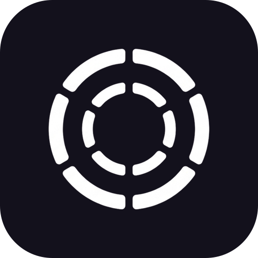

<div align="center">



# DisTerm

**Your terminals and agents on an infinite canvas.**

Multiple real terminals live as draggable nodes on a single pan/zoom canvas, and every
project doubles as a **Trello-style board of live Claude Code sessions**. Built for
people with ADHD and scattered workflows: a spatial layout instead of a stack of
hidden tabs.

[%20·%20Linux%20(x64)%20·%20Windows%20(x64%2C%20beta)-black)](#-build-from-source)
[](https://www.electronjs.org/)
[](./LICENSE)

[Install](#-install) · [Features](#-features) · [Build from source](#-build-from-source) · [Architecture](#-architecture) · [License](#-license) · [Attribution](#attribution)

</div>

---

DisTerm is a personal fork of [nodeterm](#attribution), branded under
[Distriib](https://distriib.com). It is for personal use, not a commercial product.

## Why DisTerm

Stacked terminal tabs hide context — you lose track of what's running where. DisTerm
turns that into a **map**: every shell is a node you can place, group, label, and zoom
into. Sessions are spatial and persistent, so your mental model stays intact across
restarts. And because the app is built around a clean service seam, the same canvas runs
two ways: as the **desktop app for macOS, Linux and Windows (beta)**, and as a
**self-hosted browser app** you reach from anywhere (Server Edition).

## ✨ Features

### Everything is a node

Right-click the canvas to open a **terminal** — or an AI **agent**. Each runs in its own
persistent tmux session, next to **sticky notes** (link one to feed an agent context),
**Monaco editors**, **diff views**, and **web/video** nodes — arranged spatially, like a
map. Quit the app, even **restart the machine** — every session comes back.

### Know when an agent needs you

Hook-driven status — no output scraping: pulsing **RUNNING / NEEDS YOU** badges,
**subagent** cards with live transcripts, a per-node **context meter**, and OS
notifications. Click the ping, answer the permission prompt right in the node, and get
told the moment the turn is **done**. On a MacBook, agents live in the **notch** too.

### One project, two views

Every project is a canvas — **and also a kanban board**. Cards *are* your live
sessions: drag them across columns while the agent keeps running, open a card into a
**live card modal** (the real session + members, due date, priority, comments), and
assign teammates. Toggle with `⌘⇧B`.

### Talk to your terminal

Hold `⌘⌥`, say it, let go. On-device **Whisper** transcribes it locally and types the
text into the terminal's prompt — **you** press Enter (nothing auto-submits). Your voice
never leaves the machine.

### Node kinds

🖥 **Terminal** (xterm + tmux, AI naming) · 🤖 **Agent** (Claude Code / Codex / Antigravity /
Gemini / GitHub Copilot / opencode / Grok / Cursor / custom) · 📝 **Sticky note** (link to an agent as context) · 🗂 **Group**
(bind to a **git worktree** for agent-per-branch) · ✏️ **Editor** (Monaco, ⌘S) ·
🔀 **Diff** · 🌐 **Web / Video**

### More

- **Session continuity (tmux)** — terminals keep running across node remounts *and* full
  app restarts, including live processes; machine reboots restore scrollback and resume
  agent sessions (`claude --resume`). A macOS package carries its own tmux when you build one
  into it (see [Build from source](#-build-from-source)); a tmux already on your system is
  always used in preference to it, and terminals opened before an upgrade stay as they were
  until you refresh the node.
- **Agent superpowers** — **context links** so agent nodes read each other's transcripts
  on demand; Claude-only **branch a conversation** and **managed accounts** for several
  logged-in Claude identities side by side; agents can drive the canvas (open nodes,
  spawn teams, verify each other's work) via the built-in canvas-control CLI.
- **Remote / SSH projects** — open a project on a remote host over SSH; terminals, files,
  git, and even the board run there while the canvas stays local.
- **Source control** — VS Code-style stage/unstage, discard, branch switch/create,
  commit, push/sync/publish, **worktrees**, and `gh` sign-in — backed by system `git`.
- **GitHub Issues on Kanban** – opt-in issue cards, exact label-to-column mapping,
  All / GitHub / Sessions filtering, and two-way move, close, and reopen sync. See
  [setup and security details](./docs/github-issues-kanban.md).
- **AI commit messages & terminal names** — bring-your-own local agent CLI run read-only
  on the staged diff or captured output.
- **Power & sleep** — while an agent is working, DisTerm keeps the machine from
  idle-sleeping, and lets go the moment it finishes (on by default; toggle in the setup
  tour or Settings → Behavior). It lets the machine sleep anyway on battery below 5% or
  when the machine runs critically hot. No app can hold a machine awake through a closed lid
  (a Mac with the lid closed stays awake only while plugged in with an external display) —
  for overnight runs keep the laptop open and plugged in, or run the agents on a box
  that doesn't sleep via the [Server Edition](./docs/SERVER.md).
- **Command palette** (⌘K), **file explorer** (⌘⇧E), **markdown view** (⌘M),
  **undo/redo**, and a native macOS dark UI.

### Off by default: anything that needs a relay

DisTerm ships with no relay server and no push backend, so these stay disabled, and say why in
the app, unless you run your own and start DisTerm with both `NODETERM_RELAY_URL` and
`NODETERM_API_BASE`. A working relay needs both, because the second is where relay tokens come from.
Push needs `NODETERM_API_BASE`.

- phone remote access
- Team Access and hosted teams
- Live Links
- push notifications and the push webhook

Everything above this section works without them.

**`NODETERM_API_BASE` also moves the license, check and project-limit calls.** `src/core/license.ts`,
`src/core/check.ts` and `src/core/project-limit.ts` read the same variable, so setting it sends those
calls to your server instead of `api.nodeterm.dev`, and your server's replies then decide the answers.
For example, a check-shaped reply with no `limits` key reads as the project limit being off. Clause (b)
of the Additional Use Grant in [`LICENSE`](./LICENSE) requires that the copy you use "has not had its
license key, entitlement or usage-limit functionality moved, changed, disabled or circumvented", and
says changing those mechanisms "for non-production purposes, such as developing, testing or
contributing to the Licensed Work, remains permitted". Read that clause before you set this variable
on a copy you use in production.

### What still reaches the upstream server

While `NODETERM_API_BASE` is unset, license checks and the free-tier open-project limit call
`api.nodeterm.dev`, unchanged, and the fork leaves that code as it is because of clause (b) of the
license (above). The limit is switched on or off by that server (see
[`docs/project-limit.md`](./docs/project-limit.md)).
Settings → Privacy controls only the open-project count sent with the check. The fork removed
upstream's telemetry ping, update feed, in-app announcements and mandatory-update policy.

### 🌍 Server Edition — DisTerm in your browser

The same canvas runs headless on a Linux (or macOS) host and is used from any browser —
so your terminals, editors, source control, board, and agents live on a server you reach
from anywhere. Single-user auth (password + secure cookie), a WebSocket bridge, and the
exact same renderer as the desktop app.

```bash
npm run server:dev     # build + serve; open http://127.0.0.1:8443 and set a password
```

Terminals, files/editor/diff, the full git panel, the kanban board, and agent-status
badges all work in the browser today. See [`docs/SERVER.md`](./docs/SERVER.md) for the
quickstart, security model, and current limitations.

## 📦 Install

There are no prebuilt downloads: build DisTerm from source. See
[Build from source](#-build-from-source) for the requirements, then package for your platform:

```bash
npm install
npm run dist:linux   # or: npm run dist (macOS), npm run dist:win (Windows)
```

The packages land in `dist/`. They are unsigned, and a package has no update feed, so to update,
pull and build again.

**Removing it:** `scripts/uninstall.sh` stops every process the app started, reverts the
status-hook/skill entries it merged into your agent CLIs' config (your own hooks and credentials
are never touched), and deletes the app's own state. Run it with `--dry-run` first to see the full
list of what it found:

```bash
bash scripts/uninstall.sh --dry-run
bash scripts/uninstall.sh --yes
```

The full inventory of what the app writes where (and what the script keeps, like the
`.nodeterm/` canvas folders inside your own repos) is documented in [docs/uninstall.md](docs/uninstall.md).

## 🛠 Build from source

Requires Node.js `^22.22.2 || ^24.15.0 || >=26.0.0` (`engines` in `package.json`) on **macOS 12
Monterey or newer** or Linux (tmux recommended — it's
what makes sessions survive restarts). A source checkout does **not** carry the bundled tmux: run
`node scripts/build-tmux.mjs` once on macOS to build it into `resources/bin/tmux`, or just install
tmux yourself. On **Windows**, run
`bootstrap-windows.bat` from a fresh checkout first — it checks for Node, the Visual Studio
C++ build tools and Python 3 (needed to compile node-pty) and points you at the exact
`winget` commands for anything missing, then runs `npm ci`.

On **Fedora** (and any distro shipping GCC 14 or newer), export `CFLAGS=-D_GNU_SOURCE` for the
install: smart-whisper's bundled whisper.cpp uses GNU-only CPU-affinity calls without asking for
them, and GCC 14 turned that from a warning into an error, so a plain `npm install` fails while
building it. Packaging additionally wants `rpm-build` (for the `.rpm` target) and
`libxcrypt-compat` (electron-builder's bundled `fpm` runs a Ruby that still links
`libcrypt.so.1`, without which both `.deb` and `.rpm` fail):

```bash
sudo dnf install -y rpm-build libxcrypt-compat
CFLAGS=-D_GNU_SOURCE npm install
```

```bash
npm install        # deps + rebuilds node-pty against Electron's ABI (postinstall)
npm run dev        # dev mode with renderer HMR
npm run build      # production build into out/
npm start          # preview the production build
npm run typecheck  # fastest correctness gate
npm test           # vitest unit + integration suite
npm run dist       # local UNSIGNED .dmg into dist/ (smoke test, Apple silicon)
npm run dist:mac:x64 # the same for Intel Macs (build it on a Mac; see CONTRIBUTING.md first)
npm run dist:linux # AppImage + .deb + .rpm into dist/ (on a Linux host; .rpm needs rpmbuild)
npm run dist:win   # unsigned NSIS installer + zip into dist/ (on a Windows host)
npm run server:dev # build + run the browser Server Edition (needs Node 22 + tmux)
```

The Linux packages install with `sudo apt install ./node-terminal_*.deb` or
`sudo dnf install ./node-terminal-*.rpm` (the package name stays `node-terminal`). The AppImage
needs FUSE 2, which Fedora does not install by default: `sudo dnf install fuse-libs` if it exits
with a `libfuse.so.2` error. The Windows installer is unsigned, so SmartScreen will ask
(*More info → Run anyway*).

**Minimum macOS is 12 (Monterey), for the app and for building it.** Both floors belong to
the toolchain, not to DisTerm: Electron 42 ships binaries for Monterey and up, so the `.dmg`
does not launch on Big Sur, and the `esbuild` binary that Vite and the Server Edition build
use is compiled with Go 1.25, which dropped macOS 11 — on Big Sur `npm install` dies in
esbuild's postinstall with `dyld: Symbol not found: _SecTrustCopyCertificateChain`, and
nothing downstream (`electron-vite`, `server:dev`) exists. An older Mac can still use DisTerm
by running the [Server Edition](./docs/SERVER.md) on a Linux host and opening it in a browser.

## ⌨️ Keyboard shortcuts

These are the defaults — every one of them is remappable in **Settings → Keyboard Shortcuts**.

| Shortcut | Action |
| --- | --- |
| `⌘K` | Command palette |
| `⌘T` / `⌘⇧C` | New terminal / New Claude Code |
| `⌘⇧B` | Toggle the kanban board |
| `⌘W` | Close the selected node |
| `⌘←` `⌘→` `⌘↑` `⌘↓` | Focus the node left / right / above / below (`Ctrl+Shift+arrow` off macOS) |
| `⌘Z` / `⌘⇧Z` | Undo / Redo |
| `⌘M` | Toggle markdown view (terminal / editor) |
| Hold `⌘⌥` (`Ctrl+Alt`) | Dictate into the focused terminal |
| `⌘⇧E` | File explorer |
| `⌘,` | Settings · `⌘/` Shortcuts |
| `Right-click` | Actions menu (empty space or node) |

**Pasting screenshots on macOS:** in a terminal, **Cmd+V** saves the image and pastes its
file path. **Ctrl+V** sends a control key to the foreground program. A local agent with
clipboard-image support, such as Claude Code, may attach the image directly at its input
prompt; shells and editors give that key other meanings. DisTerm does not detect this
capability or retry with the other route. Use Cmd+V for SSH sessions: the image is uploaded
and its remote path is pasted. In Server Edition, image paste uploads to the terminal host
and depends on browser clipboard access; Ctrl+V does not transfer the browser's clipboard
to the host. This distinction also appears in **Keyboard shortcuts → Pasting screenshots
on macOS** and applies to both canvas and kanban terminals.

## 🏗 Architecture

- **Electron, three contexts** — `src/main` (the Electron shell), `src/preload` (the only
  bridge, `window.nodeTerminal`), `src/renderer` (React UI). `src/shared` holds the types
  and IPC channel names used by all three.
- **`CorePlatform` seam** — every service (PTY, workspace/settings, git, agents, hooks) lives
  in `src/core` behind a small platform interface and never imports `electron`. Electron is
  one implementation of that seam; the browser Server Edition (`src/server`) is another,
  booting the exact same services over a WebSocket-RPC bridge (`src/renderer/bridge` fills
  `window.nodeTerminal` in the browser). One codebase, one renderer, multiple shells.
- **`TerminalTransport` abstraction** — the renderer depends only on this interface, never on
  IPC or node-pty directly. `LocalTransport` talks to the local host; `RemoteTransport` talks
  to a remote agent over SSH — so remote projects drop in without touching the canvas UI.
- **React Flow is the single source of truth** for live nodes; projects persist serialized
  nodes to disk, and tmux keeps sessions alive across restarts.
- **Two surfaces** — the desktop app and the browser **Server Edition** ride the same core +
  transport seams.

See [`docs/architecture/`](./docs/architecture/README.md) for runtime diagrams, a task-oriented
code map and a graph generated from the imports, [`docs/SERVER.md`](./docs/SERVER.md) for the Server Edition, and the
design docs under [`docs/`](./docs) for deeper notes.

## 🤝 Contributing

This is a personal fork, so issues and pull requests here may not be actively maintained.
Contributions meant for the upstream project should go to
[eneskirca/nodeterm](https://github.com/eneskirca/nodeterm).

If you do work on this code, **start with [CONTRIBUTING.md](./CONTRIBUTING.md)** — setup, the
process-boundary rules, and the house rules. [docs/reference](./docs/reference) is the deep reference behind
them, and [CLAUDE.md](./CLAUDE.md) is the short version loaded automatically if you work with an AI coding agent. DisTerm is licensed under the
[Business Source License 1.1](https://mariadb.com/bsl11/) — you can use, modify,
and redistribute it, including in production, except offering it as a competing
product or service or running a copy whose license or usage-limit checks were removed
or bypassed (see [License](#-license)).

By submitting a contribution (pull request, patch, or code snippet), you agree
that it is licensed under the same [BUSL-1.1](./LICENSE) terms as the rest of
the project, and that the project may continue to relicense future versions
(including your contribution) as part of its normal licensing model.

## 📜 License

**[BUSL-1.1](./LICENSE)** ([Business Source License](https://mariadb.com/bsl11/)): you may
copy, modify, redistribute, and — under the Additional Use Grant — make **production
use** of this software, with two exceptions: you may not offer it (hosted, embedded, or as a
standalone product/service) in a way that **competes** with the Licensed Work or with the
Licensor's products built on it, and you may not use in production a copy whose license
key, entitlement or usage-limit functionality has been **moved, changed, disabled or circumvented**
(changing that code to develop, test or contribute is fine). Each version automatically becomes
plain **MIT** four years after it is published. See [`LICENSE`](./LICENSE) for the full terms and
[`THIRD-PARTY-NOTICES.md`](./THIRD-PARTY-NOTICES.md) for the bundled open-source
components.

The Licensor's commercial-licensing contact, eneskirca@gmail.com, is for the original nodeterm
project, not for this fork.

## Attribution

DisTerm is a fork of [nodeterm](https://github.com/eneskirca/nodeterm) by Enes Kirca, licensed
under BUSL-1.1.

> "Claude" and "Claude Code" are trademarks of Anthropic, and "Trello" is a trademark of
> Atlassian; DisTerm is not affiliated with or endorsed by either.

---

<div align="center">

Made in Costa Rica · https://distriib.com · support@distriib.com

</div>
