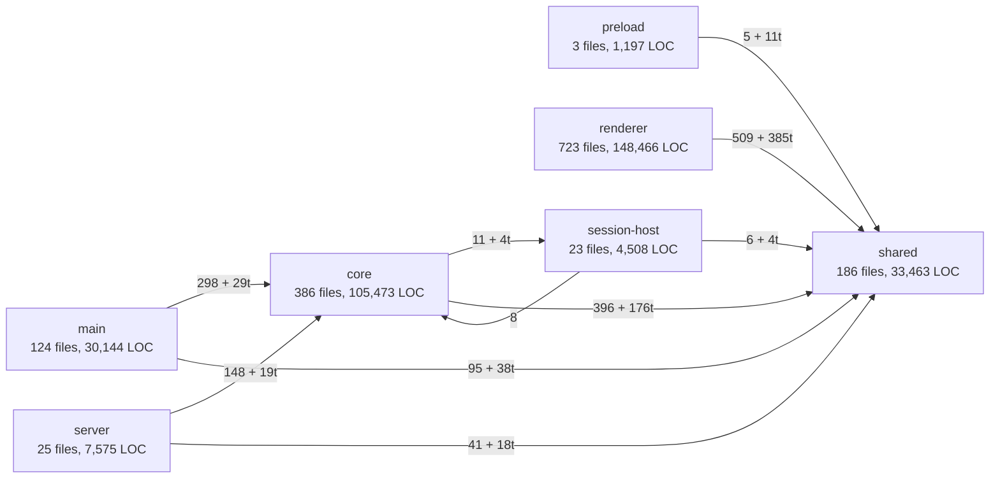
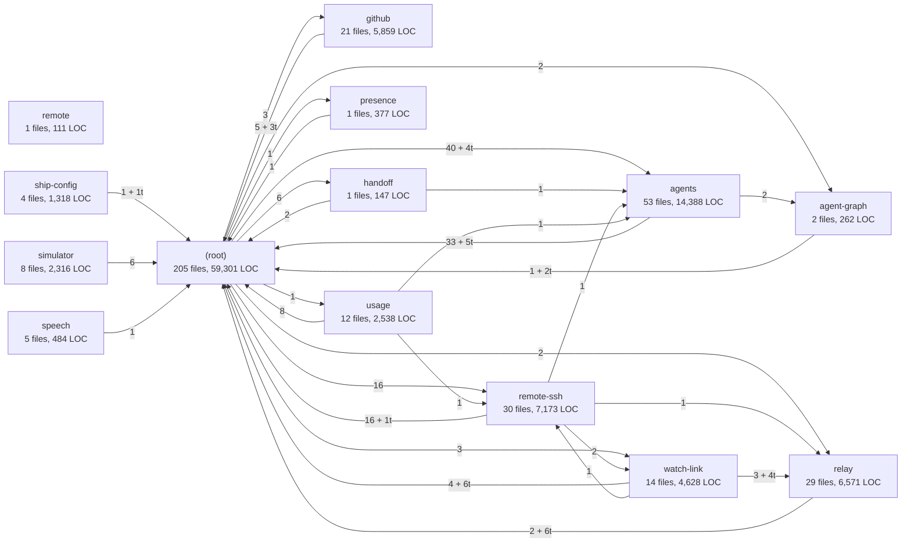
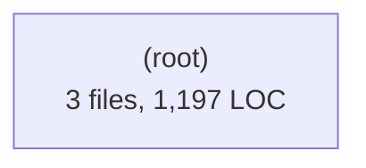
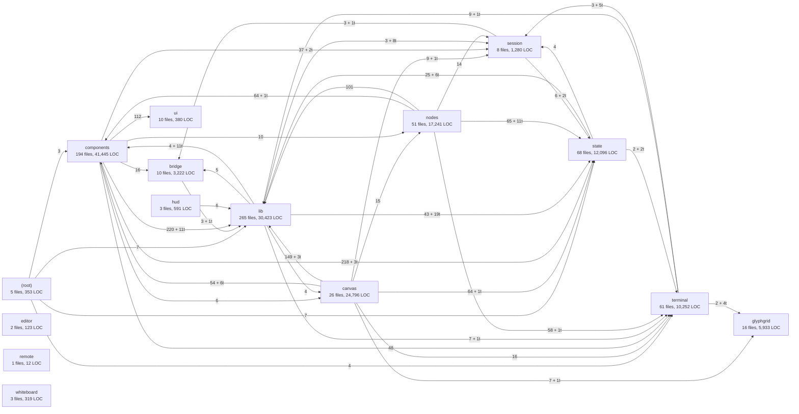
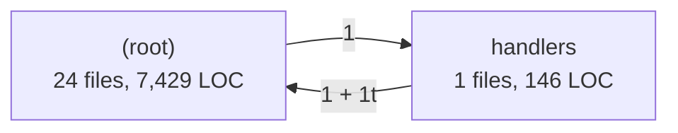
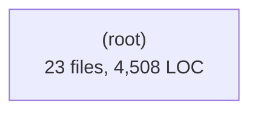
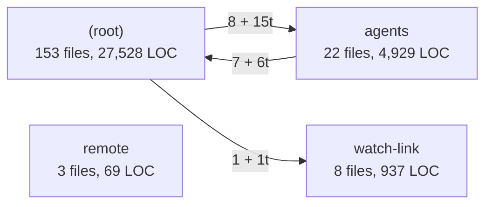

# Code map (generated)

<!-- GENERATED by scripts/architecture-graph.mjs. Do not edit: run `npm run arch:graph`. -->

Generated from the import statements under `src/`. The runtime picture that imports cannot show is in
[README.md](README.md); the same data as JSON, with every subsystem edge, is in [graph.json](graph.json).

**1,470 files, 330,826 lines of code** (non-blank), 7 process contexts, 41 subsystems, 195 subsystem edges, 10 context edges.

## What is counted

- **Left out:** 1,757 test files (`*.test.*`, `*.test-*.*`, anything under `__fixtures__`). Test helpers without that spelling (`platform-fake.ts`, `test-tmp.ts`) are counted.
- **Imports:** 7,049 statements. 5,913 land on a mapped file, 1,122 on a package, 14 on a non-code file, 0 on a left-out test file, 0 outside `src/`, and 0 resolve to nothing.
- **Not seen:** 0 `import()` calls whose argument is not a string literal, and anything loaded by path at runtime: `new URL()`, a bundler entry, a spawned bundle such as the session host.
- **Type-only** means the statement says so (`import type`, every specifier `type`, `typeof import()`). An `import { Foo }` used only as a type is elided by the bundler but counts as a value import here, because telling them apart takes a type checker. Value counts are therefore an upper bound on what reaches a bundle.
- **Scan trouble:** files not lexed cleanly: 0 (an unterminated comment, template or string, or unbalanced braces). In such a file, imports after that point may be missing or wrong.
- **Scanner limits:** this is a lexer, not a parser, and a mistake that happens to balance is not counted above. A regex literal directly after a `)` that does not close `if`, `while`, `for` or `with` reads as division, and a division directly after `}` reads as a regex. JSX is parsed by a trial in `.tsx` and `.jsx` only; an element that fails it has its text read as code. A static import inside a block (`declare module`) is not counted.
- A subsystem is the first directory under a context; files directly in a context form `<context>/(root)`.

Edge labels read `value + type-only` (`12 + 3t`); a dashed arrow is an edge with no value import at all.

## Process contexts

| Context | Files | LOC | Subsystems | Imports inside |
| --- | --- | --- | --- | --- |
| `core` | 386 | 105,473 | 14 | 836 |
| `main` | 124 | 30,144 | 4 | 201 |
| `preload` | 3 | 1,197 | 1 | 0 |
| `renderer` | 723 | 148,466 | 15 | 2,300 |
| `server` | 25 | 7,575 | 2 | 43 |
| `session-host` | 23 | 4,508 | 1 | 31 |
| `shared` | 186 | 33,463 | 4 | 301 |

## Subsystems per context

Each diagram shows imports between subsystems of one context, capped at 24 subsystems and 40 edges. What a cap drops is stated under its diagram. Imports that leave the context are listed in words.

### core

Nothing dropped from this diagram.

Imports out: `shared` 396 + 176t, `session-host` 11 + 4t. Imported by: `main` 298 + 29t, `server` 148 + 19t, `session-host` 8.

### main

Nothing dropped from this diagram.

Imports out: `core` 298 + 29t, `shared` 95 + 38t. Imported by: none.

### preload

Nothing dropped from this diagram.

Imports out: `shared` 5 + 11t. Imported by: none.

### renderer

Dropped from this diagram: 21 of 61 edges dropped; only the 40 heaviest are drawn (each with at least 3 imports).

Imports out: `shared` 509 + 385t. Imported by: none.

### server

Nothing dropped from this diagram.

Imports out: `core` 148 + 19t, `shared` 41 + 18t. Imported by: none.

### session-host

Nothing dropped from this diagram.

Imports out: `shared` 6 + 4t, `core` 8. Imported by: `core` 11 + 4t.

### shared

Nothing dropped from this diagram.

Imports out: none. Imported by: `renderer` 509 + 385t, `core` 396 + 176t, `main` 95 + 38t, `server` 41 + 18t, `preload` 5 + 11t, `session-host` 6 + 4t.

## Largest subsystems

The 20 largest of 41, by LOC.

| Subsystem | Files | LOC | Imports inside |
| --- | --- | --- | --- |
| `core/(root)` | 205 | 59,301 | 375 |
| `renderer/components` | 194 | 41,445 | 410 |
| `renderer/lib` | 265 | 30,423 | 113 |
| `shared/(root)` | 153 | 27,528 | 232 |
| `renderer/canvas` | 26 | 24,796 | 26 |
| `main/(root)` | 73 | 18,380 | 96 |
| `renderer/nodes` | 51 | 17,241 | 56 |
| `core/agents` | 53 | 14,388 | 85 |
| `renderer/state` | 68 | 12,096 | 33 |
| `renderer/terminal` | 61 | 10,252 | 19 |
| `server/(root)` | 24 | 7,429 | 40 |
| `core/remote-ssh` | 30 | 7,173 | 24 |
| `main/remote-ssh` | 13 | 6,650 | 12 |
| `core/relay` | 29 | 6,571 | 55 |
| `renderer/glyphgrid` | 16 | 5,933 | 40 |
| `core/github` | 21 | 5,859 | 38 |
| `shared/agents` | 22 | 4,929 | 18 |
| `core/watch-link` | 14 | 4,628 | 19 |
| `main/remote` | 29 | 4,581 | 43 |
| `session-host/(root)` | 23 | 4,508 | 31 |

## Most depended-on modules

The 25 of 1,439 imported files with the most distinct importing files. "Outside" counts importers from another subsystem.

| File | Importers | Outside | Value imports | Type-only imports |
| --- | --- | --- | --- | --- |
| `src/shared/types.ts` | 348 | 314 | 27 | 333 |
| `src/shared/agents/config.ts` | 109 | 101 | 91 | 24 |
| `src/shared/ipc.ts` | 86 | 84 | 86 | 0 |
| `src/core/platform.ts` | 74 | 24 | 52 | 22 |
| `src/renderer/session/session.ts` | 70 | 65 | 57 | 14 |
| `src/renderer/state/settings.ts` | 70 | 63 | 70 | 0 |
| `src/renderer/state/projects.ts` | 69 | 66 | 68 | 1 |
| `src/renderer/components/icons.tsx` | 68 | 25 | 68 | 0 |
| `src/shared/ssh.ts` | 68 | 64 | 51 | 38 |
| `src/core/fs-atomic.ts` | 48 | 28 | 48 | 0 |
| `src/renderer/state/workspace.ts` | 48 | 45 | 27 | 21 |
| `src/shared/agents/normalize.ts` | 45 | 45 | 9 | 37 |
| `src/renderer/state/agentStatus.ts` | 31 | 28 | 21 | 10 |
| `src/renderer/components/settings/SearchableRow.tsx` | 29 | 0 | 29 | 0 |
| `src/renderer/components/settings/SettingsSection.tsx` | 29 | 0 | 29 | 0 |
| `src/renderer/ui/Button.tsx` | 29 | 28 | 29 | 0 |
| `src/shared/platform-utils.ts` | 27 | 27 | 27 | 0 |
| `src/shared/safe-id.ts` | 27 | 19 | 27 | 0 |
| `src/renderer/bridge/runtime.ts` | 26 | 26 | 26 | 0 |
| `src/renderer/components/dialog-stack.ts` | 26 | 1 | 26 | 0 |
| `src/renderer/components/settings/FieldRow.tsx` | 26 | 0 | 26 | 0 |
| `src/shared/github-issue-ref.ts` | 26 | 22 | 19 | 7 |
| `src/shared/github-issues.ts` | 26 | 25 | 0 | 29 |
| `src/core/exec-path.ts` | 25 | 10 | 26 | 0 |
| `src/shared/presence.ts` | 25 | 21 | 11 | 14 |

## Forbidden boundary crossings

Imports that cross a boundary CLAUDE.md forbids. Reported here; this script fails on none of them.

| Rule | Value | Type-only | Why it is a rule |
| --- | --- | --- | --- |
| `renderer->main` | 0 | 0 | The renderer must never import src/main (process model). |
| `core->main` | 0 | 0 | src/core talks to its shell only through CorePlatform. |
| `server->main` | 0 | 0 | src/server must not import src/main. |
| `core->electron` | 0 | 0 | src/core must not import electron. |
| `server->electron` | 0 | 0 | src/server must not import electron. |

None found.
