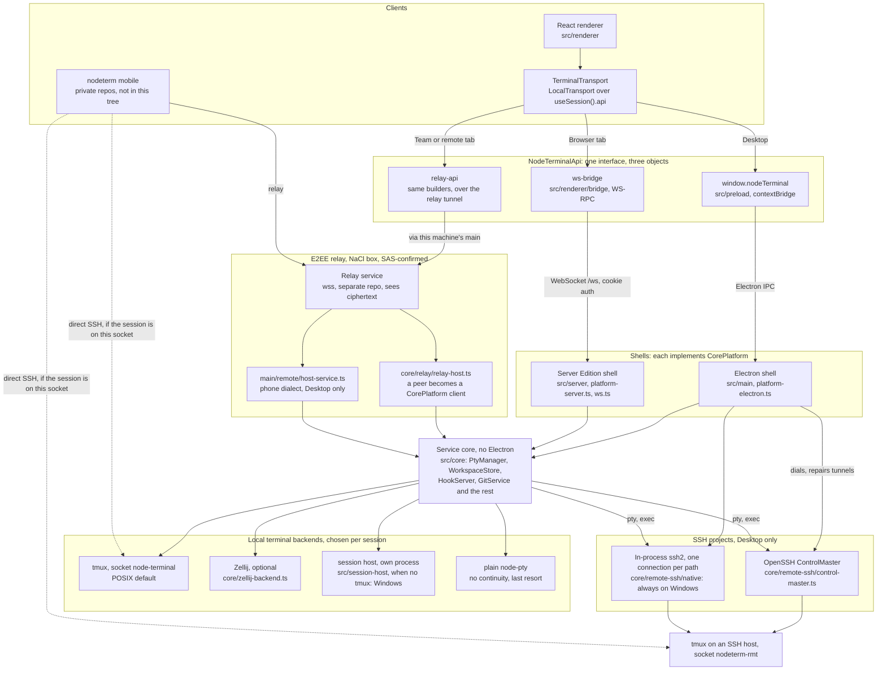
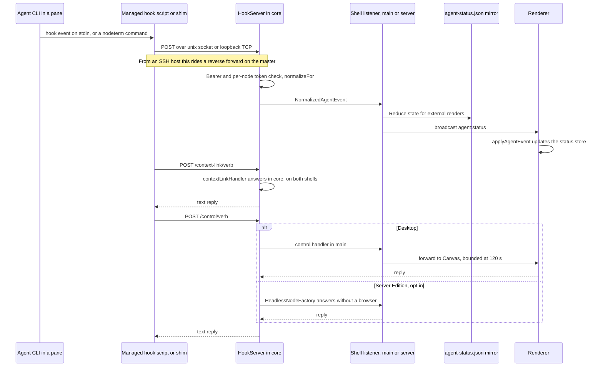

# Architecture map

Three parts:

- **[CODEMAP.md](CODEMAP.md)** is the hand-written, task-oriented index: "I need to change X: where do I start?"
- **[GRAPH.md](GRAPH.md)** and **[graph.json](graph.json)** are generated from the imports under
  `src/`: contexts, subsystems, sizes, fan-in, forbidden boundary crossings. Do not edit them. After
  a code change run `npm run arch:graph`; `npm run arch:graph -- --check` exits non-zero if they are
  stale.
- **This file** is hand-written and covers what imports cannot show: which process talks to which,
  over what. It was checked against the code when written, but nothing regenerates it. The deep
  reasoning behind each rule is in `docs/reference/`.

## Runtime

One renderer and one service core run in three arrangements. The renderer only ever sees a
`NodeTerminalApi`, and which object that is decides where its terminals run.

Things the diagram cannot say:

- **`TerminalTransport` has one implementation.** Remote access swaps the api object underneath
  `LocalTransport`; there is no `RemoteTransport` class. See `src/renderer/terminal/transport.ts`.
- **A relay tab keeps app-global namespaces local.** `pty`, `workspace`, `fs`, `git` and the canvas
  reach the remote core, while `settings`, `updates`, `license` and the relay controls stay on this
  machine (`src/renderer/bridge/relay-api.ts`). The file and folder pickers browse the host, and New
  Folder writes there, because the path they return is used on the host. Host-only channels are
  refused to every peer (`src/shared/host-control.ts`).
- **Who hosts a relay session.** `connectRelayHost` in core serves desktop Team Access
  (`src/main/remote/relay-host.ts`), a Server Edition team (`src/core/relay/hosted-service.ts`) and
  live-link viewers (`src/core/watch-link/link-host.ts`). Phones are separate: only the desktop serves
  them, through `src/main/remote/standing-host.ts` and `src/main/remote/host-service.ts` on
  `connectHostSession`, the legacy phone dialect.
- **The phone side is not in this repo.** The phone's edges describe what this repo serves; the
  client is `nodeterm-ios` and `nodeterm-android`. See [docs/ios-protocol-migration.md](../ios-protocol-migration.md).
  Direct SSH uses whichever socket holds the session: `node-terminal` when nodeterm runs on that
  machine, `nodeterm-rmt` when a desktop reaches it as an SSH project. A Windows host has no direct
  SSH path and pairs over the relay only.
- **`CorePlatform` is the seam between core and shell.** Core registers handlers through
  `platform().handle/on` and answers through `broadcast/sendTo` (`src/core/platform.ts`), so both shells
  serve the same logic. Logic written in `src/main` does not reach the browser edition.
- **SSH connections belong to the desktop shell.** `src/main/remote-ssh/ssh-project.ts` dials masters
  and sets up hooks on the host; core is handed a connection and spawns over it. The Server Edition has
  no SSH projects, because it runs on the host it serves.

## Agent status and canvas control

Agent state comes from each CLI's own hooks, never from parsing its output. The same endpoint carries
the commands agents run against the canvas.

Installers are in `src/core/agents/hooks/`, the normalizers in `src/shared/agents/normalize.ts`, and
the listeners in `src/main/index.ts` and `src/server/agent-status.ts`, which must stay in parity.

## Where state lives

`<userData>` is `userDataDir` on `CorePlatform`: Electron's user data folder, or the Server Edition's
data dir.

| What | Where | Shared? |
|---|---|---|
| Project index and machine-local fields (`viewport`, accounts, held launches) | `<userData>/workspace.json` | No |
| Folder project content | `<cwd>/.nodeterm/project.json` | Yes, git. Treat it as hostile input |
| SSH project content | The same file on the host, with an offline `cache` in the index | Yes |
| Project without a folder, or kept in app data | `<userData>/inline-projects/<id>.json` | No |
| App settings | `<userData>/settings.json` | No |
| Agent status for external readers | `<userData>/agent-status.json` | No |
| Delivery queue, station reports, hand-over holds, request ledger | `<userData>/orchestration-state/<kind>.json` | No |
| Running terminals | tmux, Zellij or the session host, outside the app process | No |

React Flow holds the live nodes of the active project only; the `projects` store holds the serialized
nodes of the rest. `src/core/workspace-store.ts` does the fan-out, so the renderer still speaks one
assembled `Workspace`.

## Further reading

| Subsystem | Document |
|---|---|
| Server Edition | [SERVER.md](../SERVER.md) |
| Remote tabs and the relay | [remote-sessions.md](../remote-sessions.md), [hosted-team-relay.md](../hosted-team-relay.md), [team-presence.md](../team-presence.md), [live-links.md](../live-links.md) |
| Phone | [ios-protocol-migration.md](../ios-protocol-migration.md), [mobile-chat-view.md](../mobile-chat-view.md), [mobile-usage-inbox.md](../mobile-usage-inbox.md) |
| Terminal backends | [session-backends.md](../session-backends.md), [windows-session-host.md](../windows-session-host.md), [session-memory.md](../session-memory.md) |
| SSH agent tooling | [ssh-agent-skills.md](../ssh-agent-skills.md) |
| Agent hooks and identity | [hook-reply-approvals.md](../hook-reply-approvals.md), [node-identity.md](../node-identity.md), [agent-integration-consent.md](../agent-integration-consent.md), [shared-codex-node-identity.md](../shared-codex-node-identity.md) |
| Agents | [grok-agent.md](../grok-agent.md), [gemini-agent.md](../gemini-agent.md), [copilot-agent.md](../copilot-agent.md), [antigravity-agent.md](../antigravity-agent.md), [cursor-agent.md](../cursor-agent.md), [codex-shared-identity.md](../codex-shared-identity.md) |
| Board and GitHub | [github-issues-kanban.md](../github-issues-kanban.md) |
| Node kinds | [trigger-node.md](../trigger-node.md), [whiteboard-node.md](../whiteboard-node.md) |
| Storage rules | [atomic-writes.md](../atomic-writes.md) |
